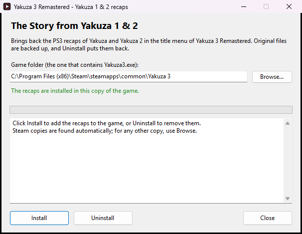

  
  
  

# Yakuza 3 Remastered — The Story from Yakuza 1 & 2 restored (PC mod)

> Unofficial mod for *Yakuza 3 Remastered* on PC: brings back the
> "The Story from Yakuza" and "The Story from Yakuza 2" recaps of the PS3
> version, straight from the title menu.

**[Download the latest version](https://github.com/Egld-Rma/Yakuza3-Recaps-Restored/releases/latest)**

## Contents

- [The project](#the-project)
- [Preview](#preview)
- [Installation](#installation)
- [Uninstallation](#uninstallation)
- [Compatibility](#compatibility)
- [What the mod changes](#what-the-mod-changes)
- [How it works](#how-it-works)
- [Report a problem](#report-a-problem)
- [FAQ](#faq)
- [Disclaimer](#disclaimer)

## The project

While researching a French translation patch for *Yakuza 3*, I found this: the
two recaps of the PS3 version, which tell the story of *Yakuza* and *Yakuza 2*
before you start *Yakuza 3*, were removed from the Remastered release. Much of
what is needed to play them is still in the PC version, though.

This mod brings them back:

- two new options in the title menu, as on PS3:
  **New Game / Load Game / The Story from Yakuza / The Story from Yakuza 2 /
  Extra / Options / Exit Game**;
- the 8 original cutscenes (4 per game, about 35 minutes in total), with sound,
  subtitles and the prompt between parts asking whether you want to keep
  watching;
- a normal return to the title menu at the end.

## Preview

  
  

  
  

## Installation

1. Download `Yakuza3_Recaps_Yakuza1and2.zip` from the
   [latest release](https://github.com/Egld-Rma/Yakuza3-Recaps-Restored/releases/latest).

2. Extract the archive anywhere (right-click → **Extract All**).

3. Close *Yakuza 3 Remastered*.

4. Run `Yakuza3 Recaps Installer.exe`.

5. A Steam copy is found automatically. For any other copy, click
   **Browse...** and select `Yakuza3.exe` in your game folder.

6. Click **Install**. The installer checks everything first, lists what it is
   going to change and asks before doing anything.

7. Start the game: the two new options are in the title menu.

  

The original files are backed up in the game folder, under `recaps_backup`.
If the game is in a protected folder, the installer offers to restart as
administrator.

> Download the archives from **Releases**. The **Code → Download ZIP** button
> does not contain the installable mod.

## Uninstallation

Run `Yakuza3 Recaps Installer.exe` and click **Uninstall**: the original files
are put back, the videos and the backup folder are removed, and the game folder
is exactly as it was before.

## Compatibility

The mod works with any PC copy of *Yakuza 3 Remastered* whose game files are
unmodified, wherever it is installed. The installer does not look at where your
copy comes from: it checks the code of `Yakuza3.exe` itself, and refuses to
touch a different build or an executable already changed by another mod.

- All 4 game languages are supported (English, Japanese, Korean, Chinese).
- If you have clear data, the title menu already has 9 options, the most the
  game can show: the recaps are not added in that case.
- Verifying the game files or an update through Steam removes the mod: just
  install it again.

## What the mod changes

- **Title menu and recap playback** — a few bytes of `Yakuza3.exe`
- **Recap scenario entries** — `data/scenario_xx/scenario.bin`
- **The 8 recap videos** — `data/mvusm/`

Full list of files changed or added

- `Yakuza3.exe` (231 bytes patched, the executable itself is not distributed)
- `data/scenario_en/scenario.bin`
- `data/scenario_ja/scenario.bin`
- `data/scenario_ko/scenario.bin`
- `data/scenario_zh/scenario.bin`
- `data/mvusm/Prologue_Ogre1_01.usm`
- `data/mvusm/Prologue_Ogre1_02.usm`
- `data/mvusm/Prologue_Ogre1_03.usm`
- `data/mvusm/Prologue_Ogre1_04.usm`
- `data/mvusm/Prologue_Ogre2_01.usm`
- `data/mvusm/Prologue_Ogre2_02.usm`
- `data/mvusm/Prologue_Ogre2_03.usm`
- `data/mvusm/Prologue_Ogre2_04.usm`

## How it works

- The PS3 code that plays the recaps is still inside the PC executable: it just
  could no longer be reached from the title menu. The mod opens the way again
  by patching a few bytes of `Yakuza3.exe` on your PC.
- The recaps' scenario entries, removed from the Remastered release, are added
  back to `scenario.bin`.
- The videos come from the PS3 version, repackaged in the format the PC version
  reads, without re-encoding.

The installer's source code is in [`source/`](source/), with
[build instructions](source/BUILD.txt). It only needs the C# compiler that
ships with Windows.

## Report a problem

Open a [GitHub issue](https://github.com/Egld-Rma/Yakuza3-Recaps-Restored/issues)
or contact me directly: **egld**.

For a report to be useful, include:

- your game version and where your copy comes from;
- what the installer says, or what happens in game;
- a screenshot or a video if possible.

## FAQ

### Are my saves compatible?

Yes. The mod does not touch save files.

### Windows says "Windows protected your PC". Is it safe?

The installer is not digitally signed (a certificate costs money, so most mods
are not). Click **More info**, then **Run anyway**. The full source code is in
this repository.

### The recaps do not show up in the title menu.

If you have clear data, the menu already has 9 options and the recaps are not
added. Otherwise, check that the installer says the recaps are installed in
your copy of the game.

### Is it compatible with other mods?

Mods that change `Yakuza3.exe` or `scenario.bin` are not compatible: the
installer detects them and changes nothing. Other mods are not affected.

### Does it work on cracked or non-Steam copies?

The installer checks the game's code, not where it comes from. If your game
files are unmodified, it works.

## Disclaimer

This is an unofficial fan mod, not affiliated with SEGA or Ryu Ga Gotoku
Studio. *Yakuza*, *Yakuza 2* and *Yakuza 3* and their content belong to SEGA.
The [MIT license](LICENSE) covers the installer's source code only.
