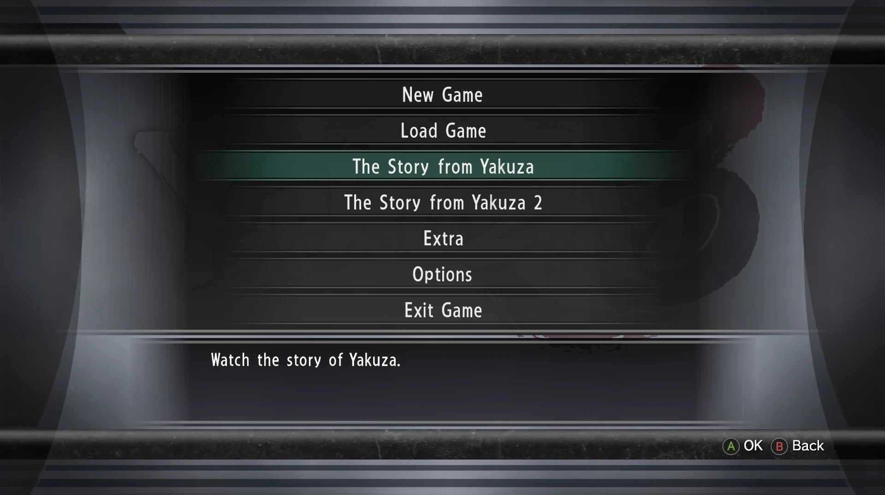
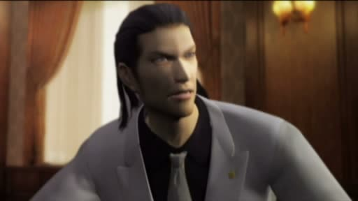
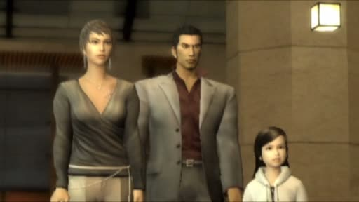
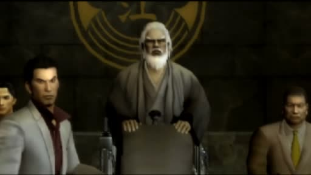
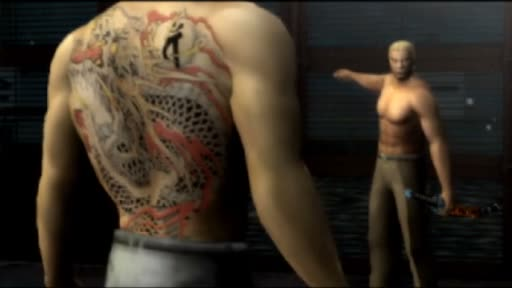

  

  
  
  

# Yakuza 3 Remastered — The Story from Yakuza 1 & 2 restored (PC mod)

> Unofficial mod for *Yakuza 3 Remastered* on PC: brings back the
> "The Story from Yakuza" and "The Story from Yakuza 2" recaps of the PS3
> version, straight from the title menu.

**[Download the latest version](https://github.com/Egld-Rma/Yakuza3-Recaps-Restored/releases/latest)**

## Contents

- [The project](#the-project)
- [Preview](#preview)
- [Installation](#installation)
- [Uninstallation](#uninstallation)
- [Compatibility](#compatibility)
- [What the mod changes](#what-the-mod-changes)
- [How it works](#how-it-works)
- [Report a problem](#report-a-problem)
- [FAQ](#faq)
- [Disclaimer](#disclaimer)

## The project

While researching a French translation patch for *Yakuza 3*, I found this: the
two recaps of the PS3 version, which tell the story of *Yakuza* and *Yakuza 2*
before you start *Yakuza 3*, were removed from the Remastered release. Much of
what is needed to play them is still in the PC version, though.

This mod brings them back:

- two new options in the title menu, as on PS3:
  **New Game / Load Game / The Story from Yakuza / The Story from Yakuza 2 /
  Extra / Options / Exit Game**;
- the 8 original cutscenes (4 per game, about 35 minutes in total), with sound,
  subtitles and the prompt between parts asking whether you want to keep
  watching;
- a normal return to the title menu at the end.

## Preview

  
  

  
  

## Installation

1. Download `Yakuza3_Recaps_v1.1.zip` from the
   [latest release](https://github.com/Egld-Rma/Yakuza3-Recaps-Restored/releases/latest).

2. Extract the archive anywhere (right-click → **Extract All**).

3. Open your game folder, the one that contains `Yakuza3.exe`
   (Steam: right-click the game → **Manage** → **Browse local files**).

4. Copy `version.dll` and the `data` folder into it. When Windows asks, choose
   **Replace the files in the destination**.

5. Start the game: the two new options are in the title menu.

No installer, nothing to run: the game loads the mod by itself.

> If the new options show up but the recaps do not play, the files in `data`
> were skipped: copy the `data` folder again and choose **Replace**.

> Download the archive from **Releases**. The **Code → Download ZIP** button
> does not contain the installable mod.

### Upgrading from v1.0

Version 1.0 used an installer. Run its **Uninstall** first, then copy the new
files as above.

## Uninstallation

Delete `version.dll` from the game folder. That is enough: the other files do
nothing without it.

To remove them too, delete `data/mvusm/Prologue_Ogre*.usm` and verify the game
files in Steam (**Properties** → **Installed Files** → **Verify integrity of
game files**).

## Compatibility

The mod works with any PC copy of *Yakuza 3 Remastered* whose game files are
unmodified, wherever it is installed. When the game starts, `version.dll`
checks the game code in memory, and changes nothing if it is a different build.

- All 4 game languages are supported (English, Japanese, Korean, Chinese).
- If you have clear data, the title menu already has 9 options, the most the
  game can show: the recaps are not added in that case.
- Verifying the game files or an update through Steam puts the original
  `scenario.bin` back: copy the `data` folder again.

## What the mod changes

- **Title menu and recap playback** — `version.dll`, which patches the game in
  memory (`Yakuza3.exe` is never modified)
- **Recap scenario entries** — `data/scenario_xx/scenario.bin`
- **The 8 recap videos** — `data/mvusm/`

Full list of files added or replaced

- `version.dll` (added)
- `data/scenario_en/scenario.bin`
- `data/scenario_ja/scenario.bin`
- `data/scenario_ko/scenario.bin`
- `data/scenario_zh/scenario.bin`
- `data/mvusm/Prologue_Ogre1_01.usm`
- `data/mvusm/Prologue_Ogre1_02.usm`
- `data/mvusm/Prologue_Ogre1_03.usm`
- `data/mvusm/Prologue_Ogre1_04.usm`
- `data/mvusm/Prologue_Ogre2_01.usm`
- `data/mvusm/Prologue_Ogre2_02.usm`
- `data/mvusm/Prologue_Ogre2_03.usm`
- `data/mvusm/Prologue_Ogre2_04.usm`

## How it works

- The PS3 code that plays the recaps is still inside the PC executable: it just
  could no longer be reached from the title menu.
- The game loads `version.dll` from its own folder before the Windows one.
  The mod's `version.dll` passes every call on to the real one from Windows,
  and at startup patches a few places of the game code in memory to open the
  way to the recaps again, after checking that every original byte is the one
  it expects.
- The recaps' scenario entries, removed from the Remastered release, are added
  back to `scenario.bin`.
- The videos come from the PS3 version, repackaged in the format the PC version
  reads, without re-encoding.

The source code of `version.dll` is in [`source/`](source/), with
[build instructions](source/BUILD.txt).

## Report a problem

Open a [GitHub issue](https://github.com/Egld-Rma/Yakuza3-Recaps-Restored/issues)
or contact me directly: **egld**.

For a report to be useful, include:

- your game version;
- what happens in game;
- a screenshot or a video if possible.

## FAQ

### Are my saves compatible?

Yes. The mod does not touch save files.

### Is the DLL safe?

`version.dll` is flagged by none of the 71 antivirus engines on
[VirusTotal](https://www.virustotal.com/gui/file/8f9f096c26f54f80e33805b55c2ff089996bc2ba143106ee379b89998447fdc5).
Its full source code is in this repository, and building it gives the exact
same file.

### The recaps do not show up in the title menu.

If you have clear data, the menu already has 9 options and the recaps are not
added. Otherwise, check that `version.dll` is next to `Yakuza3.exe`, not in a
subfolder.

### The options are there, but the recaps do not play.

The `data` folder was not copied over the game files. Copy it again and choose
**Replace the files in the destination**.

### Is it compatible with other mods?

Mods that change `Yakuza3.exe` or `scenario.bin`, or that use their own
`version.dll`, are not compatible. Mods loaded through other files are not
affected.

## Disclaimer

This is an unofficial fan mod, not affiliated with SEGA or Ryu Ga Gotoku
Studio. *Yakuza*, *Yakuza 2* and *Yakuza 3* and their content belong to SEGA.
The [MIT license](LICENSE) covers the mod's source code only.
